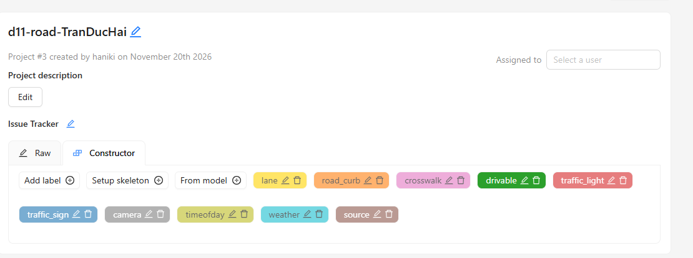
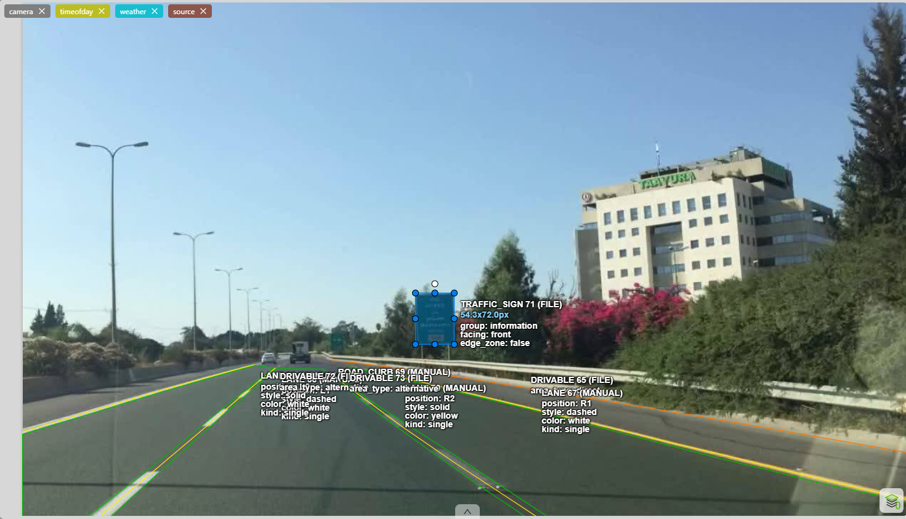
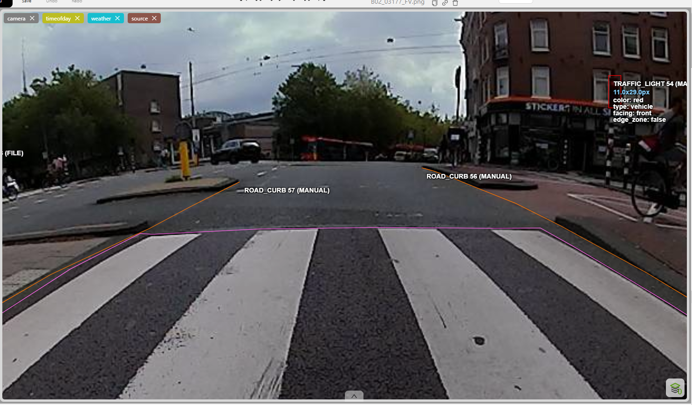
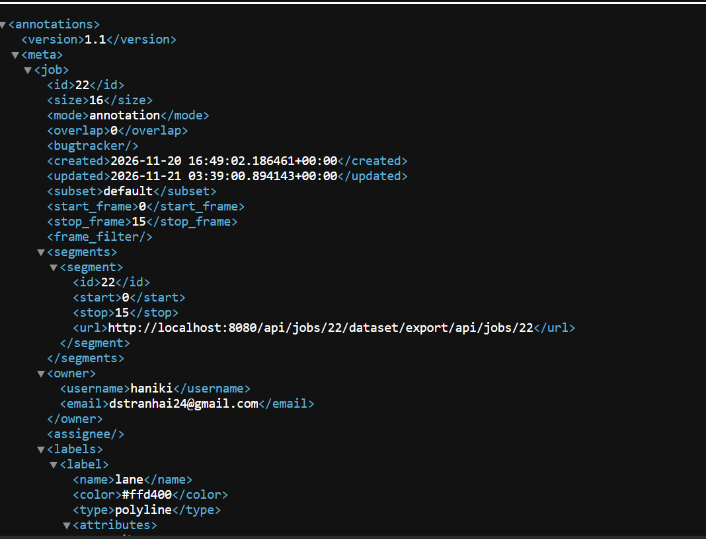

# Báo cáo cá nhân — Ngày 11
Họ tên: Trần Đức Hải    Mã học viên: 2A202603151  
Phiên bản CVAT (Help → About):  2.81.0
Guideline: Road v1.0    Lần nộp (`revision` trong manifest): 2
Thời điểm export (ngày giờ trên CVAT): Nov 22nd 26, 10:39  Số lần nộp lại sau Rework: 2  

## 1. Kiểm project

| Mục | Đúng như guideline Road v1.0? | Ghi chú |
| --- | --- | --- |
| 6 label, đúng kiểu | Có | - |
| Thuộc tính và giá trị | Có | - |
| 4 tag ảnh | Có | - |

Cách kết thúc polyline trên bản CVAT này: Vẽ line theo tâm vạch, từ gần xe ra xa; dừng ở điểm xa nhất còn nhìn rõ vạch.  
Cách đặt tag ảnh trên bản CVAT này: Gắn bốn tag ở cấp ảnh (`camera`, `timeofday`, `weather`, `source`), đặt camera trước và chọn đúng hướng camera.

## 2. Số lượng đã gán

| Task | Ảnh | lane | road_curb | crosswalk | drivable | traffic_light | traffic_sign |
| --- | ---: | ---: | ---: | ---: | ---: | ---: | ---: |
| front | 12 | 30 | 8 | 5 | 23 | 38 | 38 |
| front-extra (đã làm 4 / 4) | 4 | 8 | 2 | 5 | 7 | 14 | 16 |
| fisheye | 8 | 8 | 11 | 8 | 4 | 13 | 11 |
| fisheye-extra (đã làm 4 / 4) | 4 | 0 | 3 | 4 | 3 | 3 | 0 |

## 3. Bảng ca khó

| Ảnh | Nhãn | Phân vân giữa | Đã chọn | Lý do |
| --- | --- | --- | --- | --- |
| A13 | lane /`color` | `yellow` hay `other` | Chọn yellow | Màu trên ảnh giống màu cam hơn vàng và lane ở rìa mép đường. |

## 4. Phiếu QC 1 nhận được

Bạn kiểm lô của tôi: Nguyễn Sơn Tùng. Quyết định nhận được: **Rework**.  

| Mã lỗi | Số lỗi | Đồng ý? | Đã sửa? |
| --- | ---: | --- | --- |
| QC1-01 | 3 | Có | Có — đã đủ tag trên mọi ảnh theo manifest. |
| QC1-02 | 3 | Có | Có — A01, A02, A08 hiện có L1/R1 |
| QC1-03 | 2 | Có | Có — hai lane hiện dùng `position=other`. |

## 5. Kiểm file export

| File | Mở lại được? | Số shape ảnh 1 (job / file) | Số shape ảnh 2 (job / file) | Tag camera có trong XML? |
| --- | --- | --- | --- | --- |
| `tranduchai-front.zip` | Có | 9 / 9 (A01) | 8 / 8 (A02) | Có |
| `tranduchai-fisheye.zip` | Có | 5 / 5 (B01) | 11 / 11 (B02) | Có |

## 6. Ảnh chụp màn hình
1. Tab Labels của project. 
2. Một ảnh camera trước đã gán đủ (làn, vùng lái, đèn/biển).
3. Một ảnh fisheye đã gán, phóng to đoạn polyline cong.
4. Một đoạn XML có <polyline label="lane">. 

## 7. Tự đánh giá
Lỗi nhiều nhất theo phiếu QC nhận được là QC1-02 (thiếu L1/R1), và cách tránh ở Ngày 20: trước khi export và rà L1/R1 ở nơi vạch thực sự nhìn thấy.

Nhãn của bạn đi vào model ở đâu? Chọn một lỗi đã sửa và nói nó làm model học sai thế nào: 
- Lỗi QC1-02 đã sửa, thiếu L1/R1 trên ảnh có vạch nhìn thấy sẽ đưa mục tiêu lane sai vào dữ liệu huấn luyện. Model có thể học bỏ sót vạch và giảm khả năng phát hiện biên làn, ảnh hưởng tới tính năng giữ làn.

## 8. (Tùy chọn, buffer) Từ polyline đến đích row-anchor
| y | 720 | 680 | 640 | 600 | 560 |
| --- | ---: | ---: | ---: | ---: | ---: |
| x của chúng tôi (A02, R1) | 1156.9 | 1094.9 | 1034.1 | 974.7 | 913.5 |
| x của bạn kia (A02, R1) | 1161.2 | 1098.6 | 1037.1 | 976.4 | 914.1 |

Trả lời 3 câu:

1. Năm số x đó chính là đích mà một model row-anchor học cho vạch này. Nếu bạn dừng polyline sớm 40 px, hàng nào đổi thành "không có làn"? 
- nếu dừng sớm 40 px từ đầu xa thì không hàng nào trong năm hàng 720–560 đổi thành “không có làn”. Hàng đầu tiên bị mất sẽ nằm gần đầu xa hơn, dưới khoảng y=451.
2. So với bạn được kiểm (cùng ảnh): ở hàng 720 và hàng 560, hai bạn lệch nhau bao nhiêu pixel? Lệch ở hàng nào ảnh hưởng LKA nhiều hơn (slide 25)?
- Ở y=720 lệch 4.3 px; ở y=560 lệch 0.6 px. Hàng y=720 gần xe hơn nên sai lệch tại đó ảnh hưởng LKA nhiều hơn.
3. Nếu polyline vẽ từ xa về gần (ngược quy tắc 2), cách tính trên có đổi không? Script nào sẽ gặp khó?
- cách tính  không đổi khi đảo thứ tự điểm. `rowanchor` vẫn tính được; `road_check lint` sẽ cảnh báo QC1-04 vì polyline vẽ từ xa về gần.
